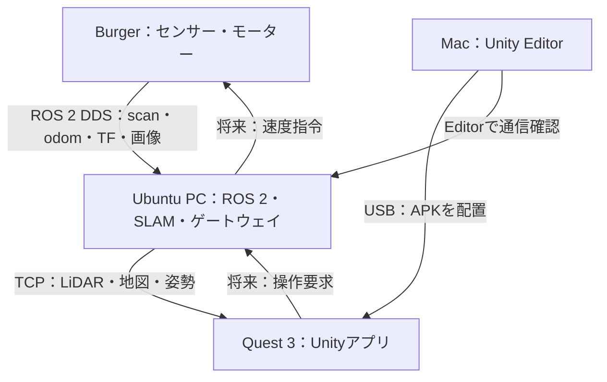

# QuestBot XR

UnityとROS 2を接続し、Meta Quest 3でTurtleBot3 BurgerのLiDAR・地図・カメラを表示するVR/MRアプリ。

最初の完成目標は、**Quest 3のVR空間に実機のLiDARスキャンを実寸で表示すること**です。

> **ステータス：設計段階**
> 現在は設計書とTODOのみで、実装・実機検証はまだ行っていません。

## 構成

| 機器 | 役割 |
|---|---|
| TurtleBot3 Burger | Ubuntu 22.04 / ROS 2 Humble。LiDAR（LDS-03）・USBカメラ・モーター |
| Ubuntu PC | ROS 2、SLAM、Nav2、Unityへの通信ゲートウェイ（ROS-TCP-Endpoint） |
| Mac | Unity開発、Android APKビルド、Questへのインストール |
| Meta Quest 3 | APKを単独実行し、Ubuntu PCへLAN接続 |

- 通信：Ubuntu側 [ROS-TCP-Endpoint](https://github.com/Unity-Technologies/ROS-TCP-Endpoint)（`main-ros2`）、Unity側 [ROS-TCP-Connector](https://github.com/Unity-Technologies/ROS-TCP-Connector)
- Unity：Unity 6 LTS系、URP、OpenXR、XR Interaction Toolkit

## 開発フェーズ

| 段階 | 実装内容 | 完了条件 | 状態 |
|---|---|---|---|
| 0 | ROSとUnityの疎通・模擬スキャン | Mac EditorとQuest APKの両方で同じ模擬形状を表示 | 未着手 |
| 1：MVP | 実機 `/scan` のVR表示 | 壁までの距離・左右・前後が実機と一致し、更新が継続する | 未着手 |
| 2 | `/map` と地図内のロボット位置 | 地図に対してロボットとスキャンが整合して動く | 未着手 |
| 3 | USBカメラ映像の仮想スクリーン | 正しい向きの映像と遅延・接続状態を表示 | 未着手 |
| 4 | パススルーMRと座標合わせ | 基準点から実空間とROS地図を位置合わせできる | 未着手 |
| 5 | 低速テレオペ・Nav2ゴール | デッドマン・切断時停止・ゴール取消しを実機で検証 | 未着手 |

最初のマイルストーンはフェーズ0〜1です。閲覧機能のみを実装し、速度指令は実装しません。

## ドキュメント

- [設計書](docs/questbot_xr_design.md)
- [TODO](todo.md)

## 記録事項

実装の進行に合わせて以下を記録します。実機で確認していない項目は完了扱いにしません。

### 採用バージョン

| 項目 | バージョン / コミット |
|---|---|
| Ubuntu PC OS / ROS 2 | 未確認 |
| Unity Editor | 未確認 |
| ROS-TCP-Connector | 未確認 |
| ROS-TCP-Endpoint | 未確認 |

### 実行コマンド

未作成（`docs/setup-ubuntu.md`・`docs/setup-mac.md`・`docs/setup-quest.md` に記載予定）

### テスト結果

未実施（`docs/acceptance.md` に記録予定）

### 未確認項目

- Ubuntu PCのOS・ROS 2ディストリビューション
- ROS-TCP-Connector / Endpoint の現行Unity・Humble・Androidでの互換性
- Endpointの購読QoSと `/scan`（Best Effort）の相性
- LiDARの正式型番、`/cmd_vel` の型、TFツリーのフレーム名
