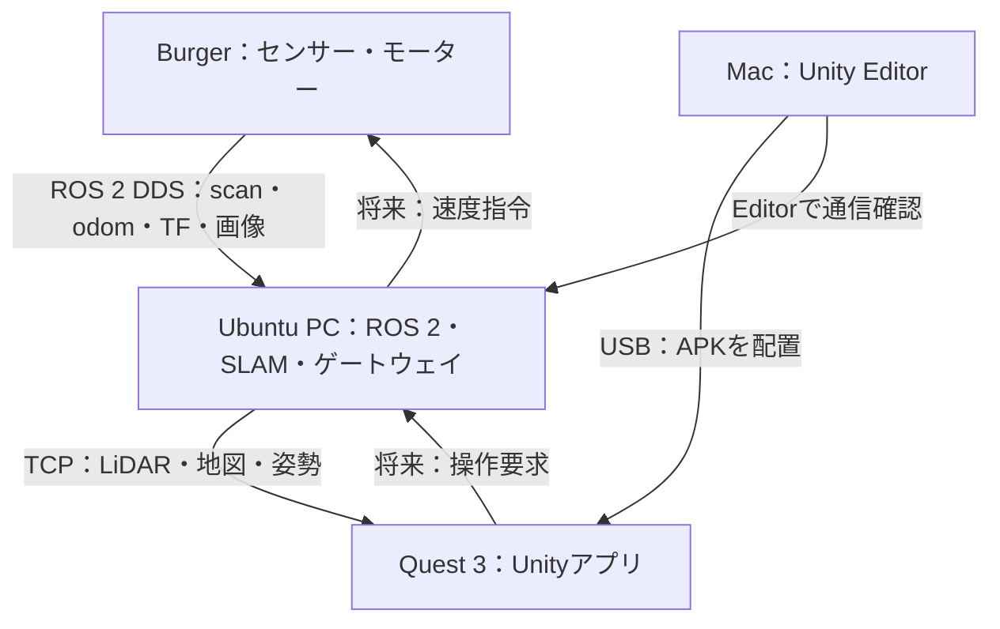

# QuestBot XR：TurtleBot3をQuest 3で見る・操作する

- リポジトリ名：`questbot-xr`
- 概要：UnityとROS 2を接続し、Meta Quest 3でTurtleBot3 BurgerのLiDAR・地図・カメラを表示するVR/MRアプリ。
- 開発：Claude Code、Unity Editor（Mac）、ROS 2（Ubuntu）。
- 最初の完成目標：Quest 3のVR空間に、実機のLiDARスキャンを実寸で表示する。

## 1. 現状と前提

| 機器 | 確認済みの状態・役割 |
|---|---|
| Burger | Ubuntu 22.04.5 ARM64、ROS 2 Humble。Bringup・OpenCR通信・LiDARの距離データ受信を確認済み |
| LiDAR | `LDS_MODEL=LDS-03`、coin_d4ドライバで `/scan` 受信済み。個体の正式型番は未確認 |
| USBカメラ | icSpring、USB ID `2993:0858`、`/dev/video0` と `/dev/video1` を認識。静止画ファイルを取得済み。画像の向きと実画質は再確認する |
| Ubuntu PC | SLAM・Nav2・Unityへの通信ゲートウェイ。OSとROSのバージョンは実装前に確認する |
| Mac | Unity開発、Android APKビルド、Questへのインストール |
| Quest 3 | APKを単独実行し、Ubuntu PCへLAN接続 |

Ubuntu PCが24.04の場合、HumbleのUbuntu 22.04用aptパッケージを直接導入しない。HumbleのVM・コンテナ、または対応OSを選び、DDSのLAN通信とGUI表示を検証する。異なるROSディストリビューション間の互換性に依存しない。

## 2. 構成



Macは開発機。実機ビルド後の通信相手はQuest 3とUbuntu PCであり、Macを常時中継しない。
Ubuntu PCは有線LAN、QuestとBurgerは同じLANのWi-Fiを基本とする。ゲストWi-Fiの端末間通信制限を避ける。

## 3. 開発フェーズ

| 段階 | 実装内容 | 完了条件 |
|---|---|---|
| 0 | ROSとUnityの疎通・模擬スキャン | Mac EditorとQuest APKの両方で同じ模擬形状を表示 |
| 1：MVP | 実機 `/scan` のVR表示 | 壁までの距離・左右・前後が実機と一致し、更新が継続する |
| 2 | `/map` と地図内のロボット位置 | 地図に対してロボットとスキャンが整合して動く |
| 3 | USBカメラ映像の仮想スクリーン | 正しい向きの映像と遅延・接続状態を表示 |
| 4 | パススルーMRと座標合わせ | 基準点から実空間とROS地図を位置合わせできる |
| 5 | 低速テレオペ・Nav2ゴール | デッドマン・切断時停止・ゴール取消しを実機で検証 |

最初は閲覧のみを実装する。SLAM未導入でもフェーズ1は実行可能。2D LiDARの点列を3D形状として誤表示しない。単眼USBカメラだけでは周囲の3D復元や深度は得られない。

## 4. Unity・Questの開発環境

1. MacにUnity Hubと、Quest/OpenXRで互換性を確認したUnity 6 LTS系Editorを導入。
2. Android Build Support、Android SDK & NDK Tools、OpenJDKをHubから追加。
3. URP、XR Plug-in Management、OpenXR、XR Interaction Toolkitを基本構成とする。
4. MR段階ではUnity OpenXR Metaの対応機能を確認して導入。必要ならMeta XR SDKを採用するが、同じ機能を提供するXR設定を無計画に重複させない。
5. Questの開発者モード・USBデバッグを設定し、Macを許可する。
6. Android・ARM64・IL2CPPを設定し、Quest向けProject Validationを解消する。
7. ネットワーク権限を有効化。OSが要求するLAN関連権限も実機で確認する。
8. Unity/パッケージ/Endpointの採用バージョンまたはコミットを固定して記録。

Mac Editorではマウス操作・模擬データで検証し、頭部追跡・コントローラー・パススルーはQuest本体で検証する。Mac上のQuest Linkを開発の前提にしない。

## 5. ROS 2とUnityの通信

### 基本案

- Ubuntu：Unity TechnologiesのROS-TCP-Endpoint（ROS 2用ブランチ）。
- Unity：ROS-TCP-Connector。ROS 2のメッセージ生成モードを選ぶ。
- 接続先：Ubuntu PCのLAN IPv4アドレスとTCPポート（例：10000）。Questで`localhost`を指定しない。
- この組合せの現行Unity・Humble・Androidでの互換性はフェーズ0で確認する。互換性を未検証のまま保証しない。
- GUIからIP/ポートを変更・保存し、再接続できるようにする。

Endpoint導入例（Ubuntu PC、Humble環境）：

```bash
source /opt/ros/humble/setup.bash
mkdir -p ~/questbot_ws/src
cd ~/questbot_ws/src
git clone -b main-ros2 https://github.com/Unity-Technologies/ROS-TCP-Endpoint.git
cd ~/questbot_ws
colcon build --symlink-install
source install/setup.bash
export ROS_DOMAIN_ID=30
export ROS_LOCALHOST_ONLY=0
ros2 run ros_tcp_endpoint default_server_endpoint --ros-args -p ROS_IP:=0.0.0.0 -p ROS_TCP_PORT:=10000
```

実装時にブランチ・CLI引数を公式READMEと照合する。Firewallの許可は信頼するLANに限定し、インターネット公開しない。

### QoSと中継

実機の `/scan` はBest Effortで受信確認済み。Endpointの購読QoSが合わない場合、Ubuntu上に小さな`rclpy`中継ノードを実装する。

- 入力 `/scan`：SensorData QoS、Best Effort、少量キュー。
- 出力 `/xr/scan`：Endpointと互換性のあるReliable、depth 1。
- 古いスキャンを蓄積せず最新優先。5〜10 Hzから始める。
- `/map`：Transient Localに対応するROS側購読で最新地図を取得し、Unity再接続時にも再送する。
- `/tf_static`：静的変換を保持。`/tf`：最新時刻の動的変換と組み合わせる。
- 動画を大量の非圧縮Imageで同じTCP回線に流して、LiDAR・姿勢の遅延を増やさない。

| データ | ROS型 | Unityでの用途 |
|---|---|---|
| `/scan` → 必要なら `/xr/scan` | `sensor_msgs/msg/LaserScan` | 距離点の表示 |
| `/map` | `nav_msgs/msg/OccupancyGrid` | 地図テクスチャ |
| `/tf`・`/tf_static` | `tf2_msgs/msg/TFMessage` | 座標変換 |
| `/odom` | `nav_msgs/msg/Odometry` | 移動量の診断 |
| ゲートウェイ `/xr/robot_pose` | `geometry_msgs/msg/PoseStamped` | map内のロボット姿勢 |
| カメラ入力（実際の名前は調査） | `sensor_msgs/msg/Image`・`CameraInfo` | 映像取得と校正情報 |
| 将来 `/xr/cmd_vel` | `geometry_msgs/msg/Twist` | ゲートウェイへの操作要求 |

## 6. LiDAR表示の実装

スキャン座標系で点を計算する。

```text
angle_i = angle_min + i * angle_increment
x_ros = ranges[i] * cos(angle_i)
y_ros = ranges[i] * sin(angle_i)
z_ros = 0
```

- NaN、Infinity、range_min未満、range_max超過を除外。今回の測定にある0.0も除外。
- ROSのFLU（前X・左Y・上Z）からUnity（右X・上Y・前Z）へ変換：`(x_u, y_u, z_u) = (-y_ros, z_ros, x_ros)`。
- 変換はROSGeometryなど1か所へ集約。Quaternionも対応関数を使い、成分を適当に入れ替えない。
- 最初はscan基準の固定パネル/実寸表示とし、移動履歴を蓄積しない。
- 地図段階ではLaserScan.header.frame_idからmapへのTFを測定時刻に合わせて適用する。
- 点はMesh/Particle等でまとめて描画し、毎フレーム点数分のGameObjectを生成しない。
- ネットワーク受信とUnityの描画更新を分離し、Unity APIはメインスレッドで呼ぶ。
- 表示縮尺・点サイズ・高さ・再センタリングをUIから操作可能にする。

## 7. 地図と自己位置

- OccupancyGrid.dataを幅×高さのTexture2Dへ変換。
- 不明(-1)は灰、空き(0付近)は白、占有(100付近)は黒。中間値の表現も定義。
- サイズはwidth×resolution、height×resolution。originの位置と回転を反映。
- ゲートウェイのtf2で `map → base_footprint`（実機TFに合わせる）を解決し、PoseStampedとしてUnityへ配信する。
- `/odom`だけでmap内の現在位置を代用しない。SLAMの位置補正を反映する。
- 地図未受信・TF欠落・古いデータをUIに明示する。

## 8. USBカメラ表示

1. `/dev/video0`の形式・解像度・FPSと、実際の撮影画像の上下を確認。
2. `v4l2_camera`または`usb_cam`のHumble対応を確認し、一方に統一。
3. まず640×480・10〜15 FPS程度から測定し、PiのCPUとWi-Fi帯域を確認。
4. UbuntuゲートウェイでJPEGフレームを配信する小規模方式から実装。HTTP MJPEGをUnityが自動再生できるとは仮定せず、明示的なデコード処理を用意する。
5. 遅延が問題ならWebRTC方式を比較し、採用Unity/Questで動作検証してから切り替える。
6. 最新フレームを仮想スクリーンへ表示。左右眼に同じ画像を出す単眼映像であり、ステレオ映像ではない。

初期実装の画像回転は表示層で行う。画像を幾何処理に使う段階ではCameraInfo・光学座標系・外部校正との整合も扱う。

## 9. MRの座標合わせ

- パススルー背景へ地図・LiDARを重ねるには、ROS mapとQuest tracking originの対応が必要。
- 最初はユーザーが既知の基準位置と向きを指定する手動校正。平面上のX/Zとyawを合わせ、床高を別途設定。
- 将来は対応するマーカー検出や空間アンカーを検証して導入。Questカメラの生画像取得権限・対応APIを事前確認。
- ROS地図の原点とQuestの原点が自動一致するとは仮定しない。
- リセンター・追跡喪失・SLAMリセット時は校正を無効化し、再校正UIを表示。

## 10. 走行操作とNav2（閲覧完成後）

- Unityから直接 `/cmd_vel` を自由に送らず、Ubuntuの操作ゲートウェイで受ける。
- デッドマン押下中だけ操作。初期上限の設計値：直進0.05 m/s、旋回0.3 rad/s。
- ROS側で最終指令から0.3秒のタイムアウトを監視し、切断・アプリ停止・フォーカス喪失時はゼロ速度へ戻す。値は実測で調整。
- キーボード操作・Nav2・VR操作の同時指令を禁止または明示的に仲裁。
- `/cmd_vel`の実際の型を `ros2 topic type /cmd_vel` で確認。Twist/TwistStampedを混同しない。
- Nav2はROS側Action Clientのブリッジから送信し、受付・進捗・取消・結果をQuestへ返す。
- 停止UIを常時表示。ソフト停止は物理非常停止の代わりにはならない。

## 11. 推奨ディレクトリ

```text
questbot-xr/
  README.md
  CLAUDE.md
  docs/design.md
  docs/setup-mac.md
  docs/setup-ubuntu.md
  docs/setup-quest.md
  docs/acceptance.md
  unity/QuestBotXR/
    Assets/QuestBotXR/Scripts/
      Networking/
      Visualization/
      XR/
      UI/
    Assets/QuestBotXR/Scenes/
    Assets/QuestBotXR/Tests/
    Packages/
    ProjectSettings/
  ros2_ws/src/questbot_xr_bridge/
    questbot_xr_bridge/
    launch/
    config/
    test/
  scripts/
```

UnityのAssetsと.meta、Packages/manifest.json・packages-lock.json、ProjectSettingsをGit管理。Library・Temp・Logs・Builds・秘密情報は除外。Endpointは固定リビジョンの依存として管理する。

## 12. Claude Codeへの実装指示

```text
この設計に従ってquestbot-xrを実装してください。
最初にUbuntu PCのOS/ROS、MacのUnity、Questの接続状態を確認してください。
フェーズ0〜1だけを最初のマイルストーンとし、速度指令は実装しないでください。
ROS-TCP-Connector/EndpointのROS2・Android互換性とQoSを最初に検証してください。
模擬LaserScanを作り、正面1mの点がUnityの正面1mに表示されることを確認してください。
NaN/Inf/ゼロ距離の除外、左右変換、切断時の古いデータ表示を検証してください。
次にBurgerの実スキャンを受信し、EditorとQuest実機で表示してください。
Unityで必要な手作業はsetup文書へ明記し、実機未確認の状態で成功と報告しないでください。
採用バージョン、実行コマンド、テスト結果、未確認項目をREADMEへ記録してください。
```

## 13. 受け入れ条件

- ROS側で `/scan` が継続受信でき、Endpointが対応QoSで購読できる。
- Unity EditorとQuest APKの両方がUbuntuのLANアドレスへ接続できる。
- 前方・左方・右方の既知の物体位置が正しく表示される。
- 地図を表示する前は「リアルタイムスキャン」であることをUIに表示する。
- スキャン更新停止1秒以内に古いデータと分かる表示へ切り替える。
- 10分間の表示でキュー・メモリが増え続けない。
- Quest描画72 FPS以上を初期目標とし、計測値を記録。センサ更新5〜10 Hzと描画FPSを分ける。
- フェーズ2以降はmap原点・回転・TF・再接続時の地図再送を検証。
- 走行機能追加時は停止・タイムアウト・指令仲裁を実機で検証してから公開する。

## 14. 公式参考資料

- ROS-TCP-Connector：https://github.com/Unity-Technologies/ROS-TCP-Connector
- ROS-TCP-Endpoint：https://github.com/Unity-Technologies/ROS-TCP-Endpoint
- ROS/Unityセットアップ：https://github.com/Unity-Technologies/Unity-Robotics-Hub/blob/main/tutorials/ros_unity_integration/setup.md
- Quest開発：https://docs.unity3d.com/ja/current/Manual/xr-meta-quest-develop.html
- Unity OpenXR Meta：https://docs.unity3d.com/ja/current/Manual/com.unity.xr.meta-openxr.html
- TurtleBot3 SLAM：https://emanual.robotis.com/docs/en/platform/turtlebot3/slam/

本書の通信・描画・速度・タイムアウト値は実装の初期設計値。実機での性能や依存互換性は未検証であり、段階ごとに測定して更新する。
